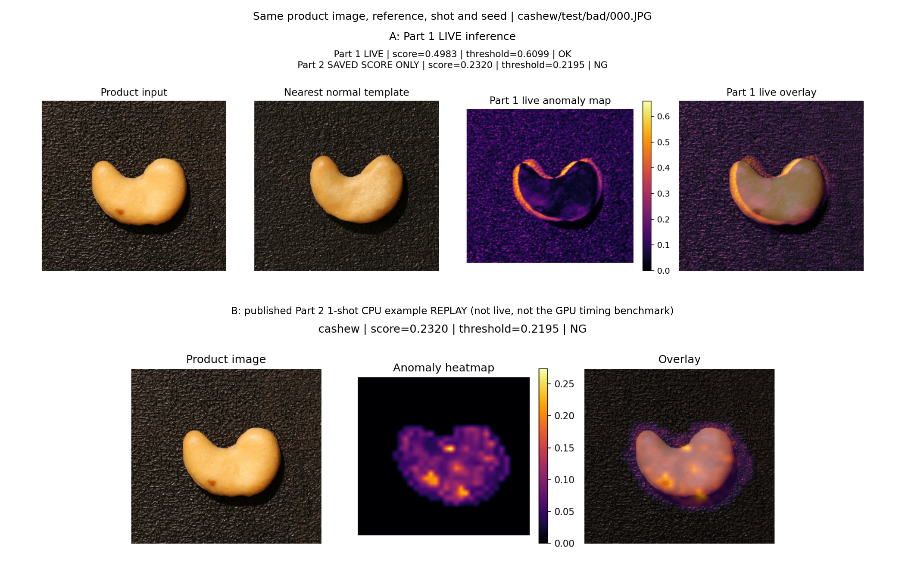

# Pre 演示（A 主负责）

接收产品图片，切换 Part 1 / Part 2，展示分数、阈值、OK/NG、热力图。Part 1 额外显示最近正常模板；真值仅用于解释。实时推理与预计算播放必须明确区分。

首个里程碑已有单图 CLI，完整命令见 [A 的说明](../docs/11_member_a_milestone.md)。`scripts/predict_part1.py` 对任意产品图片执行 Part 1 实时推理，输出图像分数、独立校准阈值、OK/NG、最近模板及原图尺寸热图；GT 不进入推理。

对于已保存的 cashew/1-shot/seed=0 测试图，附加 B 的历史分数回放；bad/000.JPG 的联合图还展示 B 已发布的相同参考配置示例，所有回放均有明确标注。它不是 A 环境中的第二个实时模型。Part 2 真正实时推理仍使用 B 的 `scripts/predict_part2.py` 和独立模型环境。

完整双模型交互界面、正式视频和 `anomaly_demo.zip` 尚未完成，不属于本次单类别里程碑。
