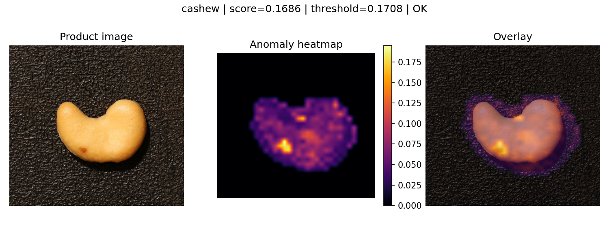
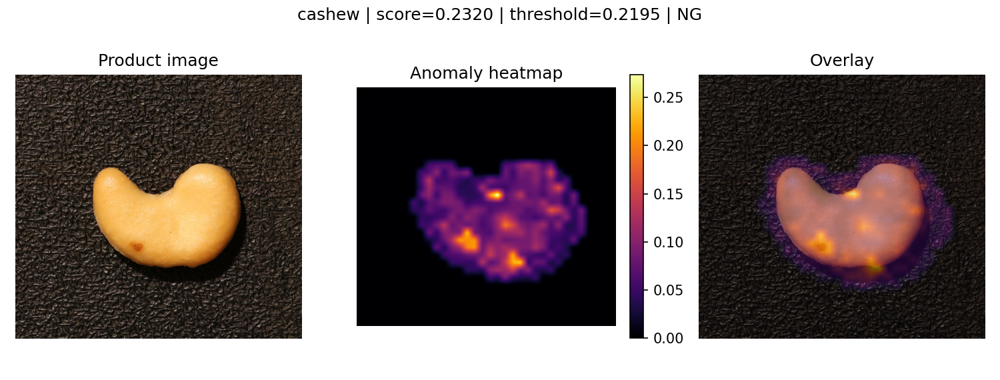

# 已验证的 Part 2 单图示例

## 正式 GPU 后端：8-shot

[`gpu_8shot/prediction.json`](gpu_8shot/prediction.json) 和下图来自真实 CLI 运行，使用主矩阵 `part2_gpu_exact_matrix_v1` 的 cashew/8-shot/seed=0 校准。输入仍为 bad/000.JPG，score=0.16863011，threshold=0.17079482，**输出 OK，是一次真实漏检**。CLI 可运行不等于每张产品图都判断正确；本例应与已保存测试预测交叉核对，并在展示中如实说明。

本次单图未预热，记录的约 69 ms 不替代完整矩阵的效率统计。原始异常图在服务器 `runs/part2_single_image_demo_gpu/anomaly_map.npz`。

## 早期 CPU 后端：1-shot

`prediction.png` 与 `prediction.json` 来自真实 `scripts/predict_part2.py` 运行：cashew/test/bad/000.JPG，1-shot，seed=0，CPU FAISS 后端，校准来源 `runs/cashew_gpu_full_v1`。score=0.23196248，threshold=0.21948904，输出 NG。脚本输入只有产品图，不读取该图真值。

此示例在 CPU 上运行，未做预热，记录的 1449 ms 不属于正式 GPU 延迟表；它也不代表 8-shot 主实验。完整原始异常图位于服务器 `runs/part2_single_image_demo_cpu/anomaly_map.npz`。

产品图来源为课程预置的 [VisA / spot-diff](https://github.com/amazon-science/spot-diff) 数据集，AnomalyDINO 特征方法来源见 [适配记录](../../../docs/07_sources_and_adaptations.md)。此处仅保存课程分析所需的代表可视化，不包含完整数据集或模型权重；数据来源及原许可证继续适用。

两个示例使用不同 reference 数及独立阈值，不能仅凭它们比较后端优劣。正式 8-shot GPU 单图运行和 A 的联合界面接入方式见 [结果与交接](../../../docs/10_part2_results.md)。
