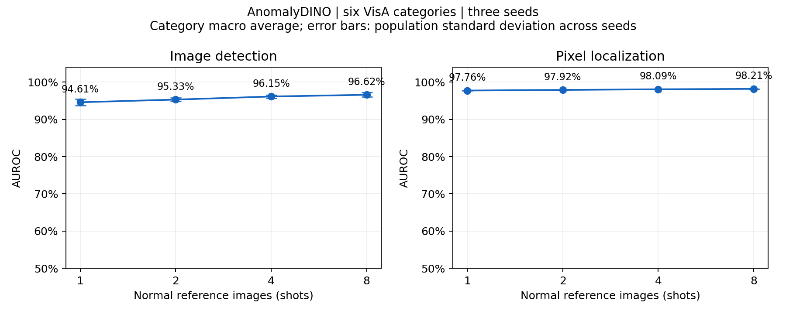
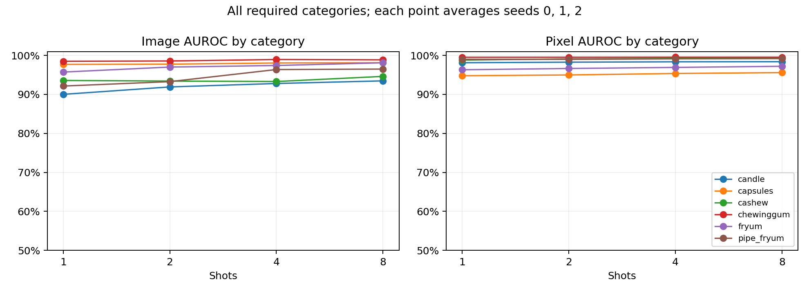

# Part 2 正式结果与成员 A 交接

## 已完成与边界

成员 B 已完成 AnomalyDINO 接入、数据协议、72 个配置的 GPU 推理与精确评价、结果汇总、五个真实阈值错误案例及单图 CLI 演示。主运行 `part2_gpu_exact_matrix_v1` 的状态为 `completed`，评价状态也是 `completed`；11,520 行测试预测的 `(category, shot, seed, image_path)` 全部唯一。所有本次推理、评价和作图任务已结束。

Part 1 仍由 A 实现；本分支没有完成两方法对比、联合展示界面、正式幻灯片/录屏或 Part 3。下面的成绩属于 Part 2，不代表课程最终成绩，也不能替代 Pre 必须展示的 Part 1。

GitHub 分支为 `codex/part2-anomalydino`。主推理代码 commit 为 `119b4c77e9c04315d7df284c4f524d35ad4433db`，启动时工作区干净；结果整理的后续提交不覆盖该来源。完整来源、模型权重 hash、核心源码 hash、GPU 负载观测和每配置记录在 [run 元数据](../results/tables/part2_gpu_run.json)。

## 正式成绩

使用 VisA 官方 1cls 划分的 candle、capsules、cashew、chewinggum、fryum、pipe_fryum。每个 shot 对三个 seed 分别计算六类别等权平均，再报告三个平均数的 mean±std（总体标准差，ddof=0）。以下 AUROC 单位为百分比，标准差单位为百分点，不是置信区间。

| 正常 reference 数 | Image AUROC (%) | Pixel AUROC (%) | 观测推理延迟 (ms/图) |
|---|---:|---:|---:|
| 1 | 94.61 ± 0.84 | 97.76 ± 0.06 | 75.57 ± 1.61 |
| 2 | 95.33 ± 0.46 | 97.92 ± 0.07 | 73.06 ± 2.26 |
| 4 | 96.15 ± 0.40 | 98.09 ± 0.03 | 74.14 ± 0.65 |
| 8 | 96.62 ± 0.57 | 98.21 ± 0.02 | 76.13 ± 2.64 |

延迟先在每个 seed 内按实际测试图数加权，再对三个 seed 求 mean±std。类别指标始终等权，未以图数加权替代 macro AUROC。共享 A6000 上存在其他负载，本表不能作为独占设备性能保证。



8-shot 各类别结果（各自三个 seed）：

| 类别 | Image AUROC (%) | Pixel AUROC (%) |
|---|---:|---:|
| candle | 93.47 ± 0.28 | 98.39 ± 0.09 |
| capsules | 98.13 ± 0.72 | 95.59 ± 0.10 |
| cashew | 94.62 ± 0.61 | 99.32 ± 0.01 |
| chewinggum | 98.87 ± 0.27 | 99.55 ± 0.00* |
| fryum | 98.11 ± 0.85 | 97.21 ± 0.01 |
| pipe_fryum | 96.49 ± 1.73 | 99.19 ± 0.02 |

\* 四舍五入为 0.00，真实标准差不是零，完整精度见 CSV。

整体随 reference 数增加而改善，但不保证每类别每一步都单调：例如 cashew 的图像 AUROC 在 1→4-shot 略降，8-shot 才提高；chewinggum 的 4-shot 图像均值略高于 8-shot。不同 shot 的参考图按官方排序分段规则选择，并非每个 seed 都是严格嵌套集合。只能报告本次选择下的观察，不能据此断言“增加样本必然提高”。capsules 的定位成绩相对较低，pipe_fryum 的图像结果对 reference 选择更敏感，适合后续重点检查。



可复核的数据：

- [72 配置明细](../results/tables/part2_gpu_per_configuration.csv)：每类别/shot/seed、指标、延迟和资源记录。
- [24 组类别/shot 汇总](../results/tables/part2_gpu_by_category_shot.csv) 与 [4 行整体汇总](../results/tables/part2_gpu_overall_by_shot.csv)。
- [11,520 行测试预测](../results/tables/part2_gpu_predictions.csv)：原始连续分数、判断阈值、正常/异常标签、图/掩码路径；其中 map_path 相对服务器原运行目录。
- [固定数据名单](../manifests/visa_1cls.json)：实际参考图、校准图、测试图，manifest SHA-256 为 `51934290ccd342f9f7fa03f9f56c712494cb7b576b7038516efdb41d43b9b2c5`。

## 可信度与实现核验

冻结 DINOv2 ViT-S/14，输入短边 448，官方 agnostic 处理；没有训练 backbone。每类排序前 20 张正常训练图仅用于阈值校准，在 reference 选择前排除。20 张校准图不属于测试集，也不加入记忆库；每配置阈值为其正常分数的第 95 百分位。AUROC 使用阈值前的连续分数，未用测试标签调参。

主运行统一使用 FP32 GPU 全量精确 k=1 L2 近邻，TF32 关闭，没有近似搜索或特征缓存。CPU FAISS 参照保留。浮点归约次序不同，不能声称逐位相同：12 张真实图片的输入特征/前景 mask 一致，图像分数最大差约 1.33e-7，patch 距离最大差约 1.05e-6。完整 cashew 配置的 image AUROC 都为 0.929；19 个完整重叠配置的 image AUROC 差值均为 0，pixel AUROC 最大绝对差 6.05e-8，见 [后端逐配置核验](../results/tables/cpu_gpu_configuration_parity.csv)。

原 CPU FAISS 矩阵只完成 19 配置后主动停止，保存作参照；本表全部取自重新执行的统一 GPU 后端 72 配置，没有拼接两个 run 的成绩。

异常图以原始 float32 patch 图加原图尺寸保存，按官方 resize + Gaussian sigma=4 重建到原图；对真实保存图验证过重建逐像素一致。像素评价包含正常测试图的零真值，使用完整原图分辨率，未逐图归一化、降采样或近似分箱。精确 GPU 像素 AUROC 与五个完整 candle 配置的 CPU 评价差值均为 0。方法与数值细节见 [GPU 实验记录](09_gpu_experiments.md)。

完成过 **21 项检查（含显式启用的 GPU 检查）**，覆盖名单隔离/参考选择、官方适配评分、异常图重建、带同分值的精确 AUROC、GPU 近邻与计数、空前景行为；另做了官方检测器真实图对照、完整配置 CPU/GPU 核验和单图演示。需要重跑检查时在服务器环境运行：

```bash
CV_TEST_CUDA=1 .venv-b/bin/python -m unittest discover -s tests -v
```

计时包括读图、预处理、DINOv2、PCA mask 和精确近邻，GPU 前后同步，排除热力图重建/导出；reference 建库另记。8-shot 的每 seed 最大类别 PyTorch 推理分配显存再跨 seed 汇总为 500.95±34.03 MiB，不包含 CUDA context/驱动或别人的占用。像素评价另需约 3.3 GiB/进程，不能把推理显存当作整项实验总显存。

## 五个真实失败案例与阈值局限

固定 8-shot/seed=0，仅用于展示错误分析，没有据此调整阈值或方法。960 张测试图共有 FP=64、FN=72，即 136 个阈值判断错误；这与高 AUROC 并不矛盾，排序质量与一个具体阈值的判断表现不同。正常测试误报率为 64/360≈17.78%，异常漏检率为 72/600=12.00%。20 张校准正常图的经验 95% 分位不能保证测试误报率为 5%。

选择规则为先尽量覆盖不同类别，再选择相对阈值偏差较大的真实错误；这是有意挑选的困难样例，不是随机样本，不能据五张图估计总体错误比例。完整 [混淆计数](../results/figures/part2_gpu_failures/threshold_confusion.csv) 与 [案例路径/分数](../results/figures/part2_gpu_failures/cases.json) 已公开。

| 案例 | 实际观察 | 可检验的解释，尚未证实 |
|---|---|---|
| [pipe_fryum 正常 400.JPG](../results/figures/part2_gpu_failures/failure_1_pipe_fryum.png) | 正常图判 NG，产品内部条状区域响应较高 | 正常外观变化在少量参考图中覆盖不足 |
| [chewinggum 正常 342.JPG](../results/figures/part2_gpu_failures/failure_2_chewinggum.png) | 正常图判 NG，右侧小区域响应明显 | 局部正常纹理/亮度变化被视作偏离 |
| [candle 正常 0427.JPG](../results/figures/part2_gpu_failures/failure_3_candle.png) | 正常图判 NG，右下蜡烛附近响应较强 | 多物体正常变化和参考覆盖可能影响分数 |
| [cashew 异常 075.JPG](../results/figures/part2_gpu_failures/failure_4_cashew.png) | 三处很小的真值缺陷，整体分数低于阈值而漏检 | patch 粒度和最高 1% 聚合可能削弱细小缺陷信号 |
| [fryum 正常 337.JPG](../results/figures/part2_gpu_failures/failure_5_fryum.png) | 正常图判 NG，右侧轮缘局部响应较高 | 正常形状/反光变化可能触发局部高分 |

热力图本身不能证明原因。Part 3 应在选定改进后另做公平消融；当前没有改进效果或消融成绩。

## A 如何接入、准备 Pre

1. 在自己的干净 clone 中先保存现有工作，再 `git fetch origin`。从 `origin/codex/part2-anomalydino` 建立自己的 Part 1 分支，例如 `git switch -c codex/part1-integration origin/codex/part2-anomalydino`。已有 Part 1 工作时走正常合并/PR，避免用 reset 覆盖自己的文件；不要与 B 共用一个正在切分支的工作目录。
2. 直接复用 `manifests/visa_1cls.json`，不要重新抽样。Part 1 同样排除 20 张校准图，再使用同一配置的 reference/test。路径和输出字段遵循 [实验协议](04_experiment_protocol.md)。
3. 先在 cashew/1-shot/seed=0 跑通 Part 1，核对 150 张测试图和路径。将连续 image score、原始浮点异常图、20 张独立校准分数导出，再做各自阈值的 OK/NG；禁止用测试缺陷标签选阈值。
4. 用公共评估核对 Part 2 现有结果，再扩展 Part 1 到 72 配置。两方法使用相同 AUROC 定义、类别宏平均/seed 汇总和计时边界。做出两方法结果表前，不能将“Part 2 已评估”当作公共对比已完成。
5. 联合演示可直接接入 `src/part2/inspector.py` 的 `fit_references()` 和 `predict()`：每个配置先建库一次，之后每图返回 score、patch_map、anomaly_map、inference_ms。按该配置独立校准阈值显示 OK/NG。已有的单图 CLI 不需要 GT 输入。
6. Pre 先确保 Part 1 可运行和可解释，再由 B 使用 [方法图](part2_method_diagram.md)、本页四 shot 表/曲线、五个错误案例及 [B 讲稿](../presentation/member_b_notes.md)。现场演示之外准备图和录屏，PPT 与正式录屏仍待双方完成。

## 服务器已有结果与操作步骤

B 的隔离工作目录为 `/data/disk1/home/sshen560/cv_final_member_b`，环境 `.venv-b`；原 clone 和共享原始数据均保留。课程数据以显式白名单的符号链接使用，没有往公共目录写入。

先查看已有成绩，无需重新占用 GPU：

```bash
cd /data/disk1/home/sshen560/cv_final_member_b
cat runs/part2_gpu_exact_matrix_v1/evaluation_status.json
cat results/tables/part2_gpu_overall_by_shot.csv
```

运行一次正式后端的单图演示（`--output` 必须为不存在的新目录；首次含模型加载和建库，单图未预热，不作为延迟 benchmark）：

```bash
nice -n 10 .venv-b/bin/python scripts/predict_part2.py \
  --image /data/disk1/home/sshen560/cv_final_data/VisA_pytorch/1cls/cashew/test/bad/000.JPG \
  --category cashew --shot 8 --seed 0 \
  --run runs/part2_gpu_exact_matrix_v1 \
  --data-root /data/disk1/home/sshen560/cv_final_data/VisA_pytorch/1cls \
  --device cuda:0 --output runs/part2_demo_pre_01
```

输出为 prediction.json、prediction.png、anomaly_map.npz；可视化展示 RGB、热力图、叠加图、score/threshold/OK-NG。上述 8-shot GPU 单图命令已实际验证，score=0.16863011、threshold=0.17079482，输出 OK；该输入是真实异常图，因此本例为漏检，不能作为正确检测的样例。见 [GPU/CPU 单图实例与解释](../demo/examples/part2/README.md)。早期 CPU 1-shot 示例使用不同 reference 和校准阈值，不能与主结果混写。

重跑完整矩阵及评价的命令见 [GPU 实验记录](09_gpu_experiments.md)。输出目录必须新建，切勿覆盖本次已完成 run。模型权重、第三方仓库、patch 图保留在服务器，GitHub 无需上传这些大文件。GPU 是共享设备，先观察负载并协调时段；没有发现 Slurm/PBS/LSF 队列，启动本项目脚本不会自动排队。
