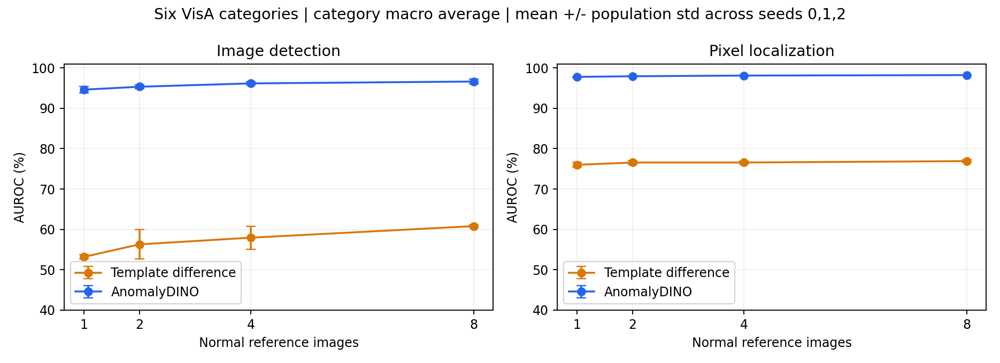

# A 的 Part 1 全量结果

## 完成范围

正式运行 `part1_full_stream_cuda_v1` 已完成。`run.json` 为 `completed`，状态 72/72，日志最终输出 `MATRIX_COMPLETED 72`；原进程已退出。按用户要求没有持续监控，在用户之后询问进度时检查终态并生成汇总。

六类 VisA、官方 1cls、1/2/4/8-shot、seed 0/1/2，共 72 配置、11,520 条配置内测试预测。保持原 RGB 模板差分方法，不以测试标签调参。20 张正常校准图在 reference 前排除，分位阈值独立计算。

## 六类总体结果

先在每个 seed 内对六个类别 AUROC 等权平均，再报告三个 seed 的均值与总体标准差（ddof=0）。以下单位为百分比，标准差单位为百分点，不是准确率或置信区间。

| Shots | Part 1 Image AUROC | Part 1 Pixel AUROC |
|---:|---:|---:|
| 1 | 53.17 ± 0.53 | 75.98 ± 0.63 |
| 2 | 56.28 ± 3.63 | 76.55 ± 0.47 |
| 4 | 57.94 ± 2.85 | 76.55 ± 0.32 |
| 8 | 60.80 ± 0.32 | 76.91 ± 0.33 |

此前 65.34% / 77.80% 是 cashew/1-shot/seed=0 的结果，仍然有效；不能把它当作六类总体成绩。模板差分的总体检测表现较弱，正常姿态/形状/背景变化的影响需要结合案例分析，而不能靠热图直接证明原因。

同协议下 B 的 8-shot 六类 image/pixel AUROC 为 96.62±0.57% / 98.21±0.02%。

## 可复核结果

- [72 配置指标](../results/tables/part1_full/per_configuration.csv)
- [类别与 shot 汇总](../results/tables/part1_full/by_category_shot.csv)
- [四种 shot 的总体汇总](../results/tables/part1_full/overall_by_shot.csv)
- [两方法完整比较](../results/tables/part1_full/comparison.csv)
- [11,520 条预测](../results/tables/part1_full/predictions.csv)
- [数据身份核验](../results/tables/part1_full/audit.json)
- [运行及源码来源记录](../results/tables/part1_full/run.json)

核验比较 category/shot/seed/image/mask/label/manifest 的全部身份，与 B 的已发布主矩阵完全一致。推理在开发工作区执行，因此元数据 `code_dirty=true`，基底 commit 为 `a3e03fb`；实际源码由 `source_sha256` 记录，不把该基底误称为已包含所有新源码。

模板推理在 CPU、2 线程上执行，不使用 GPU 模型；CUDA 只加速精确像素计数。原图 float32 像素全量参与，包括正常图的零掩码，不量化、不降采样、不逐图归一化。CPU/GPU 精确评价均核对 cashew 单配置与历史结果一致。

Part 1 的观测平均推理时间随 shot 约为 44.16 / 46.60 / 46.74 / 49.69 ms，范围包括读图、几何变换、模板选择、差分、平滑和图像分数，不含地图重建、导出和评价。与历史 GPU Part 2 运行的负载和计时阶段不同，不据此宣称受控速度比。像素评价的显存不计作 CPU 模板推理显存。

## 可视化和 Demo 边界

五个既有困难案例的对照已在 `results/figures/comparison_cases/` 生成，数值见其中 `cases.csv`。使用 B 先前选定的实际错误图片，A 用相同 8-shot/seed=0 重新推理，B 展示真实已发布图。它们不是随机样本，不估计总体错误比例。

交互 Demo 已启动，样例 API 验证通过；Part 1 实时计算，Part 2 分数明确标注为历史回放。完整浏览器/上传流程验收仍未完成，不能将 API 通过说成全部界面验收。视频、Part 3 和最终报告不在本轮完成范围。
