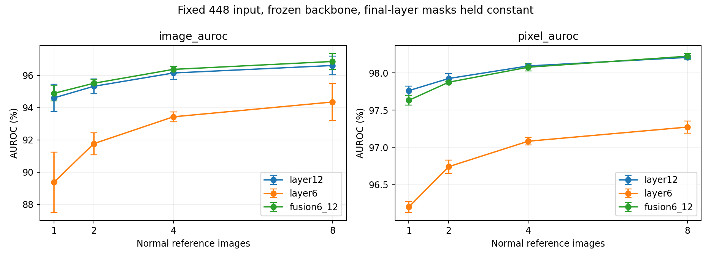

# Part 3 full ablation results

All variants use matched references/tests. The layer-12 baseline is the preserved Part 2 run. Proposed fusion was fixed before test evaluation. No test-label layer/weight search.

| Variant | Shots | Image AUROC (%) | Pixel AUROC (%) | Image delta (pp) | Pixel delta (pp) |
|---|---:|---:|---:|---:|---:|
| layer12 | 1 | 94.61 ± 0.84 | 97.76 ± 0.06 | +0.00 | +0.00 |
| layer12 | 2 | 95.33 ± 0.46 | 97.92 ± 0.07 | +0.00 | +0.00 |
| layer12 | 4 | 96.15 ± 0.40 | 98.09 ± 0.03 | +0.00 | +0.00 |
| layer12 | 8 | 96.62 ± 0.57 | 98.21 ± 0.02 | +0.00 | +0.00 |
| layer6 | 1 | 89.37 ± 1.87 | 96.20 ± 0.07 | -5.23 | -1.56 |
| layer6 | 2 | 91.77 ± 0.68 | 96.74 ± 0.09 | -3.56 | -1.18 |
| layer6 | 4 | 93.43 ± 0.31 | 97.08 ± 0.05 | -2.72 | -1.01 |
| layer6 | 8 | 94.35 ± 1.16 | 97.27 ± 0.08 | -2.26 | -0.94 |
| fusion6_12 | 1 | 94.89 ± 0.47 | 97.63 ± 0.06 | +0.28 | -0.13 |
| fusion6_12 | 2 | 95.51 ± 0.21 | 97.87 ± 0.01 | +0.19 | -0.05 |
| fusion6_12 | 4 | 96.38 ± 0.19 | 98.08 ± 0.05 | +0.22 | -0.02 |
| fusion6_12 | 8 | 96.87 ± 0.51 | 98.22 ± 0.04 | +0.25 | +0.02 |

Mean is category macro per seed, then mean/population SD over three seeds. FPR/FNR in the CSV use the same category-macro convention.

Per-category mean/SD and signed deltas are in `results/tables/part3/by_category_shot.csv`. Paired seed macro delta SD is in `overall_by_shot.csv`; this is not a confidence interval or a significance test.

Latency values use category macro for description only. The baseline was measured on a different shared-GPU load/date, so this table does not establish a controlled speed ratio. Peak PyTorch inference allocations are per configuration in the CSV; evaluator memory is separate.

## Interpretation

Equal weighting of blocks 6 and 12 modestly improved image AUROC at each shot count. Across the 12 shot–seed pairs, fusion improved the six-category macro image AUROC in 9 pairs. All three paired changes were positive at 8-shot (+0.48, +0.13, and +0.14 percentage points). Three seeds provide limited evidence about generalization to other reference sets.

Block 6 alone fell below the original block 12 baseline at every shot count on both metrics. Fusion improved image ranking even though block 6 by itself ranked images worse. This is consistent with the two layers giving complementary matching cues. Each layer uses the same patch grid, and matching uses one common reference patch. Pixel AUROC decreased by 0.13, 0.05, and 0.02 points at 1, 2, and 4 shots and increased by 0.02 at 8 shots. The small pixel changes do not establish a reliable gain in localization.

The effect varies by category. At 1-shot, pipe_fryum gained 2.56 points in image AUROC and fryum gained 1.19. Capsules lost 1.17 points in image AUROC and 1.59 in pixel AUROC. Capsules pixel AUROC fell at all four shot counts. This variation matters in industrial use where a single product line can have a different outcome from the six-category average.

At the 8-shot normal-calibration operating point, fusion lowered the macro normal false-positive rate from 15.96% to 12.07%, while the anomaly miss rate rose from 9.39% to 10.28%. The higher image AUROC measures ranking across all thresholds. The calibrated operating point still has a detection tradeoff. The [five paired cases](16_part3_failure_analysis.md) show three normal-image alerts and two missed defects that persisted under fusion.

In the same-session RTX A6000 sample, 8-shot fusion averaged 84.34 ms per image versus 80.95 ms for Part 2. Maximum PyTorch allocation across the sampled configurations increased from 381.58 to 669.58 MiB. The timing includes image loading, preprocessing, feature extraction, masking, and exact matching. Shared GPU load can affect this latency estimate. [Efficiency measurements](17_part3_efficiency.md)

The [protocol](14_part3_protocol.md) records the fixed settings, and the [audit](../results/tables/part3/audit.json) records the verified match on reference, calibration and test identities across all 216 configurations.
