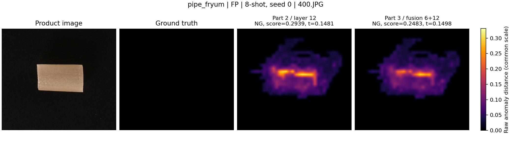
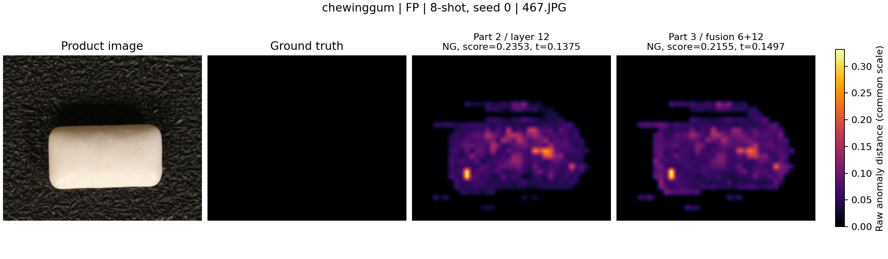
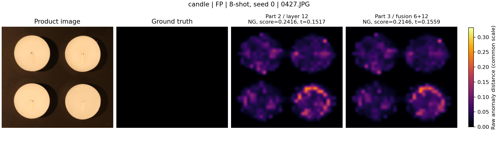
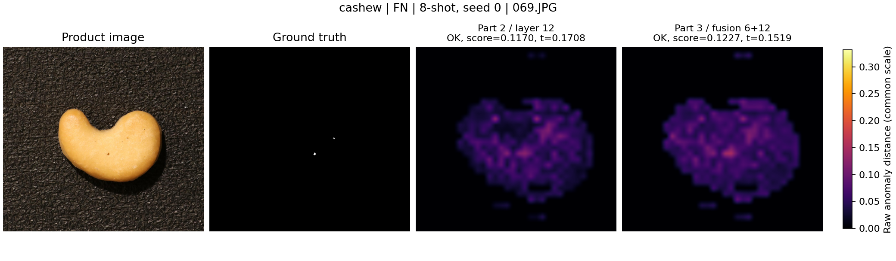
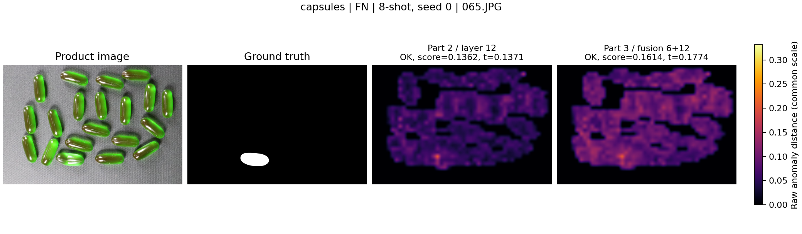

# Part 3：五个真实困难案例与 Part 2 同图对照

固定选取融合方法在 8-shot、seed=0 的真实阈值错误：优先覆盖不同类别，再按相对阈值偏差排序。这是事后错误分析，不用于选层或调整权重。所有图片、两方法使用同一原始分数色标；没有逐图归一化。

图像 AUROC 衡量排序，OK/NG 则由各方法正常校准集的 95% 分位数决定，两者需要分别解释。

## 案例 1：pipe_fryum — 正常图误报

图片 `pipe_fryum/test/good/400.JPG`；GT 缺陷面积占比 0.000%。Part 2：NG（分数 0.2939 / 阈值 0.1481）；融合：NG（0.2483 / 0.1498）。

两种热图都把试样内部的一条横线打成高分，真值掩码为空。融合减弱了这条横线上的响应，图像分数仍比融合阈值高 0.0985。这张正常图说明产品表面的局部纹理也可能触发报警。

## 案例 2：chewinggum — 正常图误报

图片 `chewinggum/test/good/467.JPG`；GT 缺陷面积占比 0.000%。Part 2：NG（分数 0.2353 / 阈值 0.1375）；融合：NG（0.2155 / 0.1497）。

左下边缘的明亮反光附近在两种热图中均形成热点，产品内部也有响应。融合降低了图像分数，报警仍持续。反光是与图中热点位置一致的候选原因，需要光照受控的测试来验证。

## 案例 3：candle — 正常图误报

图片 `candle/test/good/0427.JPG`；GT 缺陷面积占比 0.000%。Part 2：NG（分数 0.2416 / 阈值 0.1517）；融合：NG（0.2146 / 0.1559）。

最强响应出现在右下蜡烛的部分轮廓，真值掩码为空。融合减弱了热区，蜡烛边缘仍被打成高分。这类轮廓响应会占据图像分数聚合使用的高分 patch。

## 案例 4：cashew — 异常图漏检

图片 `cashew/test/bad/069.JPG`；GT 缺陷面积占比 0.015%。Part 2：OK（分数 0.1170 / 阈值 0.1708）；融合：OK（0.1227 / 0.1519）。

两个标注区域合计只占原图的 0.015%。融合将标注区域平均热图值从 0.099 提到 0.122，最热约 1% 的原图像素中只有 1.3% 落在标注区域，分数仍低于阈值。两层共用同一 patch 网格，增加特征维度并未给这两个小区域提供更细的空间采样。

## 案例 5：capsules — 异常图漏检

图片 `capsules/test/bad/065.JPG`；GT 缺陷面积占比 1.420%。Part 2：OK（分数 0.1362 / 阈值 0.1371）；融合：OK（0.1614 / 0.1774）。

融合提高了标注胶囊上的平均响应（0.085 到 0.118），同时也提高了标注区域之外的平均响应（0.031 到 0.049）。热图上可见多个未标注胶囊变亮，最热约 1% 像素落在标注内的比例仅从 31.3% 变为 31.7%。融合的图像分数升高 0.0252，正常校准阈值升高 0.0403，结果仍为漏检。

案例来自同一 8-shot、seed 0 设置，原始记录含真值面积、分数、阈值和热区统计。[案例数据](../results/figures/part3/paired_failures/cases.json)
