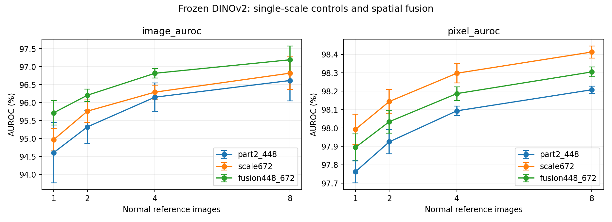

# Part 3 multiscale ablation

The frozen Part 2 at 448 is the baseline. The 672 and 448+672 variants share a 672 PCA mask. The previous study motivated the hypothesis. Scales and weights were fixed before the new outputs.

| Variant | Shots | Image AUROC (%) | Pixel AUROC (%) | Image delta (pp) | Pixel delta (pp) |
|---|---:|---:|---:|---:|---:|
| part2_448 | 1 | 94.61 ± 0.84 | 97.76 ± 0.06 | +0.00 | +0.00 |
| part2_448 | 2 | 95.33 ± 0.46 | 97.92 ± 0.07 | +0.00 | +0.00 |
| part2_448 | 4 | 96.15 ± 0.40 | 98.09 ± 0.03 | +0.00 | +0.00 |
| part2_448 | 8 | 96.62 ± 0.57 | 98.21 ± 0.02 | +0.00 | +0.00 |
| scale672 | 1 | 94.97 ± 0.31 | 97.99 ± 0.08 | +0.36 | +0.23 |
| scale672 | 2 | 95.76 ± 0.31 | 98.14 ± 0.06 | +0.44 | +0.22 |
| scale672 | 4 | 96.29 ± 0.20 | 98.30 ± 0.05 | +0.14 | +0.20 |
| scale672 | 8 | 96.82 ± 0.46 | 98.41 ± 0.03 | +0.20 | +0.21 |
| fusion448_672 | 1 | 95.72 ± 0.34 | 97.89 ± 0.07 | +1.11 | +0.13 |
| fusion448_672 | 2 | 96.21 ± 0.17 | 98.03 ± 0.06 | +0.88 | +0.11 |
| fusion448_672 | 4 | 96.82 ± 0.13 | 98.19 ± 0.04 | +0.67 | +0.09 |
| fusion448_672 | 8 | 97.19 ± 0.39 | 98.30 ± 0.03 | +0.58 | +0.10 |

Mean is category macro per seed, then mean/population SD over three seeds. FPR/FNR in the CSV use the same category-macro convention.

Per-category mean/SD and signed deltas are in `results/tables/part3_multiscale/by_category_shot.csv`. Paired seed macro delta SD is in `overall_by_shot.csv`; this is not a confidence interval or a significance test.

Latency values use category macro for description only. The baseline was measured on a different shared-GPU load/date, so this table does not establish a controlled speed ratio. Peak PyTorch inference allocations are per configuration in the CSV; evaluator memory is separate.

The tiny subset uses nonempty masks covering at most 0.1% of original image pixels. See `tiny_defects_by_shot.csv` for category-macro recall of tiny GT pixels in the top 1% of map pixels and the miss rate with an empirical test FPR capped at 5%. The FPR-capped analysis compares operating points. The OK/NG demo threshold is fit on normal calibration data.

## What the matched controls show

Fusion improved image AUROC over both controls in all 12 shot–seed pairs after averaging the six categories. Its mean gain over Part 2 ranged from 0.58 to 1.11 percentage points across the four shot counts. Relative to the 672 control, fusion added 0.37 to 0.75 points in image AUROC and lost 0.10 to 0.11 points in pixel AUROC. The results describe three reference selections per shot on the six VisA categories.

We quantified test-image uncertainty with 4,000 paired, category-and-label-stratified bootstrap replicates. A sampled image keeps the same bootstrap weight across variants, shots and reference seeds. At 1-shot the gain over Part 2 is 1.11 points, with a 95% percentile interval of [0.50, 1.74]. The gain over 672 is 0.75 [0.30, 1.20]. Both intervals still exclude zero after adjusting for eight shot/control contrasts. At 8-shot the gain over Part 2 is 0.58 [0.10, 1.07]. Its adjusted interval of [−0.07, 1.25] includes zero. This post hoc analysis is conditional on the observed categories and reference selections. [Paired bootstrap estimates](../results/tables/part3_multiscale/paired_image_bootstrap.json)

The small-defect subset contains 195 distinct images with nonempty masks covering at most 0.1% of the original image. At 8-shot the empirical normal-image FPR was 4.33% for all variants under the 5% cap. Each value averages the six categories and three seeds.

| 8-shot method | Small-defect image miss rate | Small-defect GT pixel recall in the hottest 1% |
|---|---:|---:|
| Part 2 (448) | 29.36% | 88.78% |
| Single scale (672) | 29.47% | 92.26% |
| Fusion (448+672) | 25.75% | 92.50% |

Finer sampling accounted for most of the improvement in small-defect hotspot coverage. Fusion improved the image decision at this empirical operating point. Deployment examples use the per-category 95th-percentile threshold from the reserved normal training images. Under that demo threshold, five small-defect images at 8-shot seed 0 changed from OK with both controls to NG with fusion. For example, `cashew/test/bad/044.JPG` covers 0.0695% of the original image and scored 0.1458 against the fusion threshold of 0.1414. This is an illustrative test example. The cashew image that motivated the study (`069.JPG`) remained a miss for all three methods.

At 8-shot, the fusion-minus-448 small-defect miss-rate estimate is −3.62 pp. Its image-paired 95% bootstrap interval is [−10.45, +2.06] pp. Against 672, the estimate is −3.72 pp with interval [−7.86, +1.23] pp. In 4,000 draws, we resampled normal images and tiny-defect images within each category, reused the same draws across the methods and reference seeds, and re-estimated the empirical FPR cutoff in each draw. Both intervals span zero. The 195-image result is a useful operating-point trend with more uncertainty than the 1-shot image AUROC comparison. [Small-defect uncertainty](../results/tables/part3_multiscale/paired_tiny_fnr_bootstrap.json)

The same-session RTX A6000 sample measured 73.30, 142.07, and 205.81 ms/image at 8-shot for 448, 672, and fusion, respectively. Peak allocated PyTorch memory was 381.58, 742.05, and 1390.05 MiB. The shared device and sample size limit deployment latency estimates. [Efficiency protocol and measurements](20_part3_multiscale_efficiency.md)

## Remaining failures

All five cases below were actual fusion threshold errors at 8-shot seed 0, selected from distinct categories by relative distance from the threshold. The three heatmaps use one raw color scale. All three methods give the same incorrect decision on each selected image.

| Case | What the comparison shows |
|---|---|
| [Pipe fryum 400](../results/figures/part3_multiscale/fusion_failures/failure_1_pipe_fryum.png) | The strongest response follows an internal stripe in a normal item. Fusion reduces the 672 response there and the image still scores above its threshold. |
| [Chewing gum 467](../results/figures/part3_multiscale/fusion_failures/failure_2_chewinggum.png) | A hotspot persists near the bright lower left edge. The location is consistent with a reflection, though these images alone cannot establish its cause. |
| [Candle 0427](../results/figures/part3_multiscale/fusion_failures/failure_3_candle.png) | The lower right candle rim attracts a strong response at both resolutions. A finer grid still localizes the normal edge as anomalous. |
| [Capsules 066](../results/figures/part3_multiscale/fusion_failures/failure_4_capsules.png) | The marked upper left capsule has weak contrast against responses on the surrounding normal capsules. The fusion score remains under its threshold. |
| [Cashew 071](../results/figures/part3_multiscale/fusion_failures/failure_5_cashew.png) | Two tiny marks are visible in the ground truth. Finer heatmaps show local responses, yet the top-patch average remains too low for rejection. |

[Identity and settings audit](../results/tables/part3_multiscale/audit.json) · [Per-configuration metrics](../results/tables/part3_multiscale/per_configuration.csv) · [Case records](../results/figures/part3_multiscale/fusion_failures/cases.json)
